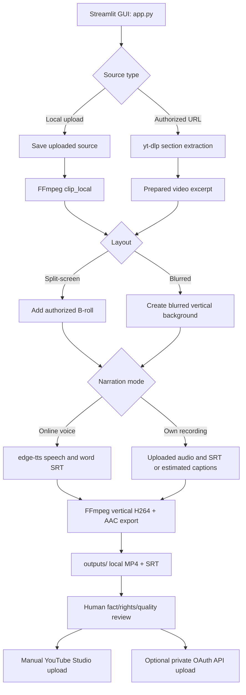

# Architecture

## Purpose and limits

Shorts Maker is a **local** media pipeline to reduce repetitive editing, not a legal clearance system or a public web platform. The operator must select and verify the video, script, source permissions, and publishing metadata.



## Major modules

| Module | Purpose | Key dependencies |
|---|---|---|
| `app.py` | Streamlit fields, validation, temporary files and playback | streamlit, pathlib |
| `shorts_core.py` | timestamp parsing; YouTube URL whitelist; source preparation; audio and SRT generation; FFmpeg render | stdlib, ffmpeg/ffprobe, edge-tts, yt-dlp |
| `upload_youtube.py` | Explicitly approved OAuth upload; defaults to private; optional scheduling | Google APIs |
| `tests/` | Tests of validation, synthetic clip and actual offline render | pytest, FFmpeg |

## Technical design choices

- `subprocess.run` receives **argument lists** with no shell interpolation.
- Allowed remote link hostnames are restricted to HTTPS YouTube pages; this is input validation, **not** proof of legal rights.
- Uses `TemporaryDirectory` to dispose of intermediate source clips, while exports are stored in `outputs/`.
- H.264/AAC in MP4 at 1080×1920 and 30 fps for broad platform/device support.
- Source audio is **muted**: reduces overlapping speech and copyrighted music but does not resolve source-video copyright.
- FFmpeg's subtitle filter burns the `.srt` track into the export; caption style can be customized.
- Generated AI speech supplies word timestamps; own-audio mode accepts a prepared SRT, or estimates timings **without listening to audio**.
- `upload_youtube.py` requires manual approval and uses OAuth; secrets and tokens are Git-ignored.

## Architecture trade-offs

1. Local render is privacy-friendly, but depends on the computer staying on and having enough CPU/memory/disk space.
2. Streamlit offers quick UI development but is not a hardened multi-user production backend.
3. Unofficial link/TTS adapters can break; local-file upload and own-voice paths preserve core functionality.
4. AI voice word alignment is convenient; speech synthesis service commercial rights require independent verification.
5. The code does not yet discover clips automatically; user sets timestamps, writes or pastes original scripts, and reviews the final result.

## Scope of a possible v2

Replace unreliable network adapters with formally licensed services; add permission-aware source library and explicit media provenance, transcription/forced alignment for own-voice SRT, batched project files, analytics import and improved integration/CI tests. See [ROADMAP](ROADMAP.md).


## v1.3 natural voice subsystem

```
Streamlit app (Python 3.14; app.py)
    |
    +-- existing edge-tts generator (online; may have service restrictions)
    +-- uploaded user audio (local)
    +-- natural_voice.py (validates settings, separate-process bridge)
            |
            +-- .voice-venv/Scripts/python.exe (Python 3.12)
                    |
                    +-- tools/kokoro_worker.py
                    +-- models/kokoro-v1.0.int8.onnx
                    +-- models/voices-v1.0.bin
                    +-- narration.wav
    |
    +-- words.srt [Kokoro word timing is estimated]
    +-- shorts_core.render_video() -> MP4
```

The model files and optional Python environment are deliberately excluded from Git. Their upstream licenses differ from the application's MIT license. The optional subprocess allows the stable upstream library (Python <3.14) to work alongside the user's current Python 3.14 Streamlit application. For correct word-level captions, integrate a separately validated speech aligner in a future release.
